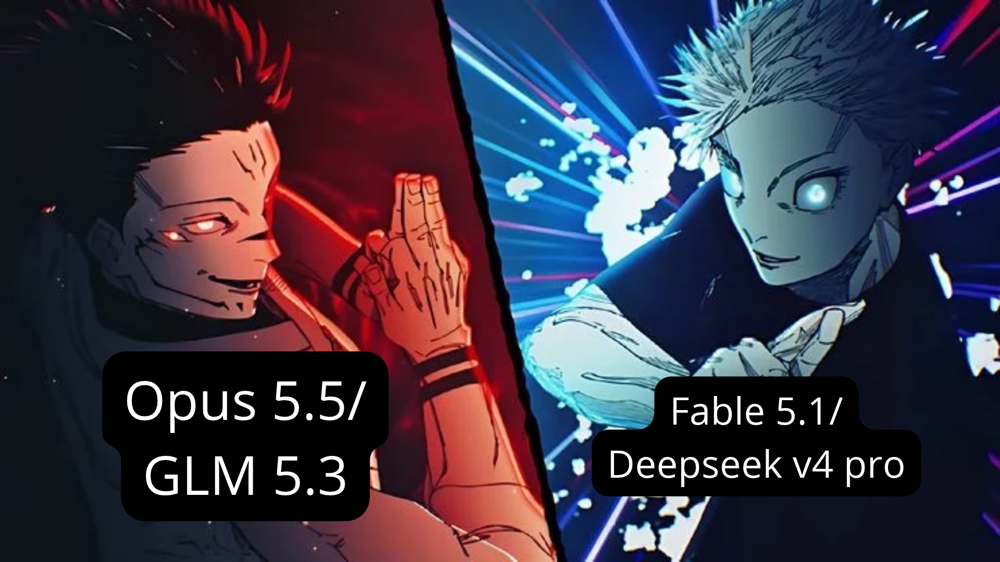

# GARIS BESAR SISTEM

Sistem penyusunan dan validasi butir soal berbasis Taksonomi Bloom melalui simulasi debat empat agen menggunakan dua model AI independen.

<p align="center">
  
</p>

## Prasyarat Sistem

- Node.js 18+ dan pnpm
- Python 3.11+

## Panduan Instalasi

### 1. Backend

```bash
cd backend
python -m venv venv
.\venv\Scripts\activate
pip install -r requirements.txt
copy .env.example .env
alembic upgrade head
uvicorn app.main:app --reload --port 8000
```

### 2. Frontend

```bash
cd frontend
pnpm install
copy .env.local.example .env.local
pnpm dev
```

